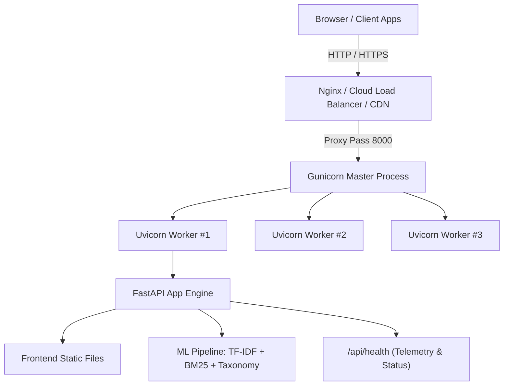

# SkillMatch AI — Production Deployment & DevOps Guide

This guide details enterprise-grade deployment strategies, containerization procedures, environment configurations, and monitoring practices for the **SkillMatch AI** platform.

---

## 1. Architecture Overview

SkillMatch AI is an asynchronous ML-powered recommendation and skill mapping service:
- **Application Engine**: FastAPI (ASGI)
- **Production Server**: Gunicorn process manager with `uvicorn.workers.UvicornWorker`
- **Machine Learning Core**: Scikit-Learn TF-IDF Vectorizer + Rank-BM25 + Domain Skill Taxonomy
- **Frontend Layer**: Vanilla JavaScript, Canvas-based Radar Visualization, responsive CSS design served directly via FastAPI `StaticFiles`
- **Health & Telemetry**: Built-in `/api/health` monitoring memory, uptime, model status, and indexed openings



---

## 2. Environment Variables Configuration

Copy `.env.example` to `.env` to configure your runtime environment:

```bash
cp .env.example .env
```

| Variable | Type | Default | Description |
| :--- | :--- | :--- | :--- |
| `ENVIRONMENT` | string | `production` | Set to `production`, `staging`, or `development` |
| `HOST` | string | `0.0.0.0` | Bind host address (`0.0.0.0` for all interfaces) |
| `PORT` | integer | `8000` | Port on which the HTTP server listens |
| `WORKERS` | integer | `4` | Number of worker processes (recommended: `2 * CPU_CORES + 1`) |
| `LOG_LEVEL` | string | `info` | Logging verbosity: `info`, `warning`, `error`, `debug` |
| `ALLOWED_ORIGINS` | string | `*` | Comma-separated list of allowed CORS domains or `*` |
| `WEB_CONCURRENCY` | integer | `4` | Gunicorn concurrency override |
| `GUNICORN_TIMEOUT` | integer | `120` | Worker timeout in seconds before recycle |
| `GUNICORN_KEEPALIVE` | integer | `5` | Keepalive timeout for persistent connections |

---

## 3. Local Production Execution

### Option A: Using the Production Launcher (`run.py`)

Run the optimized multi-worker launcher:

```bash
# Production mode (binds 0.0.0.0:8000 with multi-worker concurrency)
python run.py --prod

# Custom port and worker allocation
python run.py --prod --port 8080 --workers 4 --log-level info
```

### Option B: Using Gunicorn (Linux / macOS / WSL)

```bash
# Run with gunicorn_conf.py configuration
gunicorn -c gunicorn_conf.py backend.main:app
```

---

## 4. Container Deployment (Docker & Docker Compose)

The application includes an optimized multi-stage `Dockerfile` built on `python:3.11-slim`, utilizing non-root security privileges (`appuser:10001`), Docker layer caching, and native healthchecks.

### 4.1. Build & Run with Docker CLI

```bash
# 1. Build the Docker image
docker build -t skillmatch-ai:latest .

# 2. Run container in background with port 8000 mapped
docker run -d \
  --name skillmatch-app \
  -p 8000:8000 \
  -e ENVIRONMENT=production \
  -e WORKERS=4 \
  --restart unless-stopped \
  skillmatch-ai:latest

# 3. Verify container health status
docker ps --filter "name=skillmatch-app"

# 4. View container logs
docker logs -f skillmatch-app
```

### 4.2. Run with Docker Compose

To launch with resource constraints and health monitoring:

```bash
# Start service in detached mode
docker-compose up -d

# Check service status and healthcheck
docker-compose ps

# View real-time logs
docker-compose logs -f skillmatch-web

# Stop the service
docker-compose down
```

---

## 5. Cloud Platform Deployments

### 5.1. Render (Blueprint / 1-Click Deploy)

Render automatically detects the provided [`render.yaml`](file:///d:/my%20projects/ML%20project/render.yaml):

1. Push your repository to GitHub / GitLab.
2. In the Render Dashboard, click **New +** > **Blueprint**.
3. Connect your repository. Render will automatically parse `render.yaml`.
4. Click **Apply**. Render will build the Docker container and deploy the service with `/api/health` monitoring enabled.

### 5.2. Railway

1. Install Railway CLI or connect via GitHub: `railway login`.
2. Initialize project: `railway init`.
3. Link and deploy: `railway up`.
4. Railway will automatically pick up the [`Procfile`](file:///d:/my%20projects/ML%20project/Procfile) or [`Dockerfile`](file:///d:/my%20projects/ML%20project/Dockerfile) and expose the public URL.

### 5.3. AWS Elastic Container Service (ECS Fargate)

1. **Push to Amazon ECR**:
   ```bash
   aws ecr get-login-password --region <region> | docker login --username AWS --password-stdin <account_id>.dkr.ecr.<region>.amazonaws.com
   docker tag skillmatch-ai:latest <account_id>.dkr.ecr.<region>.amazonaws.com/skillmatch-ai:latest
   docker push <account_id>.dkr.ecr.<region>.amazonaws.com/skillmatch-ai:latest
   ```
2. **Create ECS Task Definition**:
   - Launch type: `FARGATE`
   - Memory: `1024 MB`, CPU: `512` (0.5 vCPU)
   - Port mapping: `8000`
   - Healthcheck: `CMD-SHELL, curl -f http://localhost:8000/api/health || exit 1`
3. **Configure Application Load Balancer (ALB)**:
   - Target group port: `8000`
   - Health check path: `/api/health`
   - Matcher: `200`

---

## 6. Linux VPS & Reverse Proxy Setup (Nginx + Systemd)

For standalone virtual private servers (Ubuntu / Debian / RHEL):

### 6.1. Systemd Service Unit

Create `/etc/systemd/system/skillmatch.service`:

```ini
[Unit]
Description=SkillMatch AI Application Service
After=network.target

[Service]
Type=simple
User=www-data
Group=www-data
WorkingDirectory=/var/www/skillmatch-ai
Environment="PATH=/var/www/skillmatch-ai/venv/bin"
EnvironmentFile=/var/www/skillmatch-ai/.env
ExecStart=/var/www/skillmatch-ai/venv/bin/gunicorn -c gunicorn_conf.py backend.main:app
Restart=always
RestartSec=5

[Install]
WantedBy=multi-user.target
```

Enable and start the service:
```bash
sudo systemctl daemon-reload
sudo systemctl enable skillmatch
sudo systemctl start skillmatch
sudo systemctl status skillmatch
```

### 6.2. Nginx Reverse Proxy Configuration

Create `/etc/nginx/sites-available/skillmatch.conf`:

```nginx
server {
    listen 80;
    server_name yourdomain.com www.yourdomain.com;

    # Redirect HTTP to HTTPS
    return 301 https://$host$request_uri;
}

server {
    listen 443 ssl http2;
    server_name yourdomain.com www.yourdomain.com;

    ssl_certificate /etc/letsencrypt/live/yourdomain.com/fullchain.pem;
    ssl_certificate_key /etc/letsencrypt/live/yourdomain.com/privkey.pem;
    ssl_protocols TLSv1.2 TLSv1.3;
    ssl_ciphers HIGH:!aNULL:!MD5;

    client_max_body_size 15M;

    # Gzip Compression for static assets
    gzip on;
    gzip_types text/plain text/css application/json application/javascript text/xml application/xml;

    location / {
        proxy_pass http://127.0.0.1:8000;
        proxy_http_version 1.1;
        proxy_set_header Upgrade $http_upgrade;
        proxy_set_header Connection "upgrade";
        proxy_set_header Host $host;
        proxy_set_header X-Real-IP $remote_addr;
        proxy_set_header X-Forwarded-For $proxy_add_x_forwarded_for;
        proxy_set_header X-Forwarded-Proto $scheme;
        proxy_read_timeout 90;
    }
}
```

Enable site and test configuration:
```bash
sudo ln -s /etc/nginx/sites-available/skillmatch.conf /etc/nginx/sites-enabled/
sudo nginx -t
sudo systemctl reload nginx
```

---

## 7. Health Monitoring & Observability

### Health Check Endpoint
Query the `/api/health` endpoint:

```bash
curl -s http://localhost:8000/api/health | jq .
```

Sample JSON response:
```json
{
  "status": "healthy",
  "service": "SkillMatch AI",
  "version": "2.0.0",
  "environment": "production",
  "uptime_seconds": 3612.4,
  "timestamp": "2026-10-14T15:20:00.123456+00:00",
  "ml_engines": {
    "parser": "active",
    "recommender": "active",
    "taxonomy_skills_count": 213,
    "indexed_internships_count": 24,
    "candidate_pool_count": 6,
    "applications_count": 3
  },
  "system": {
    "python_version": "3.11.8",
    "memory": {
      "rss_mb": 142.3,
      "vms_mb": 780.1,
      "cpu_percent": 0.5
    }
  }
}
```

---

## 8. Automated Testing & Quality Assurance

Run the test suite before deploying:

```bash
# Run all 32 unit and integration tests
python -m pytest -v

# Run with test coverage report
python -m pytest --cov=backend tests/
```

Continuous integration is handled automatically via GitHub Actions in [`.github/workflows/ci.yml`](file:///d:/my%20projects/ML%20project/.github/workflows/ci.yml).
